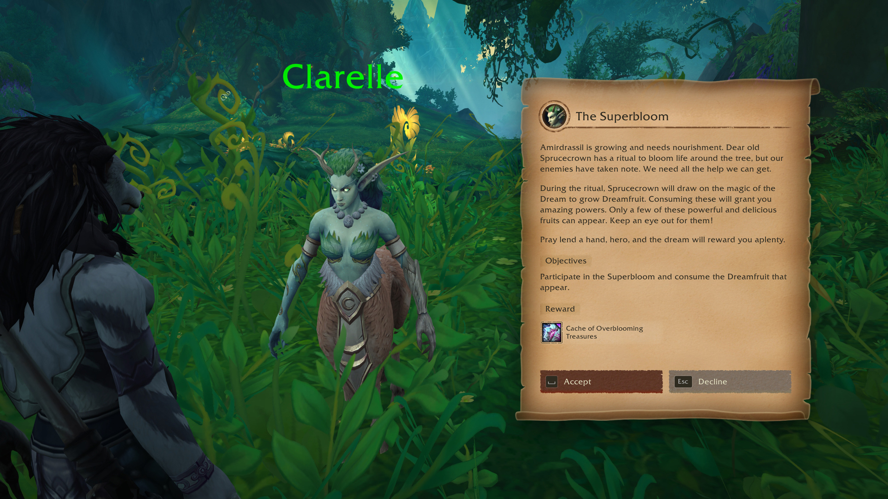
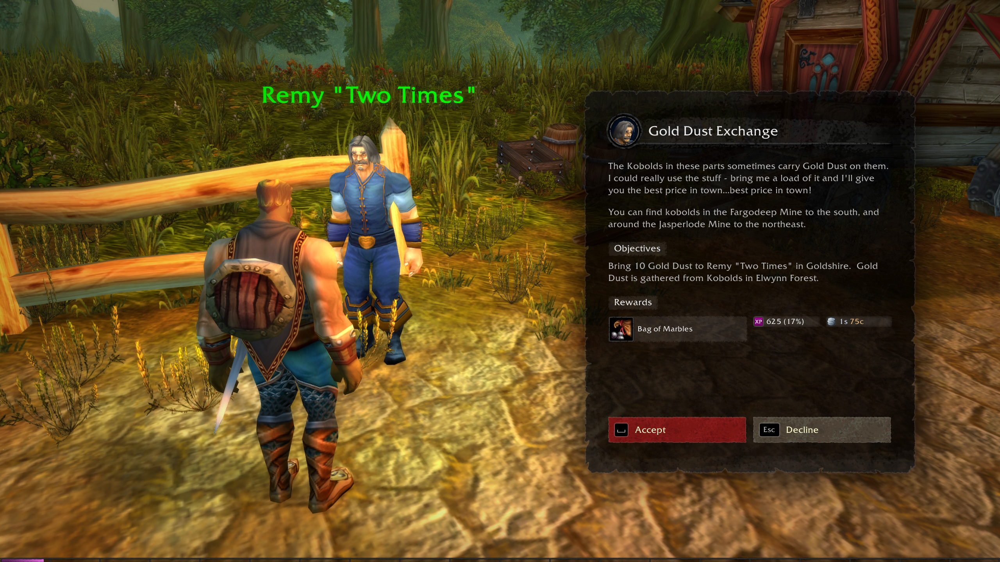
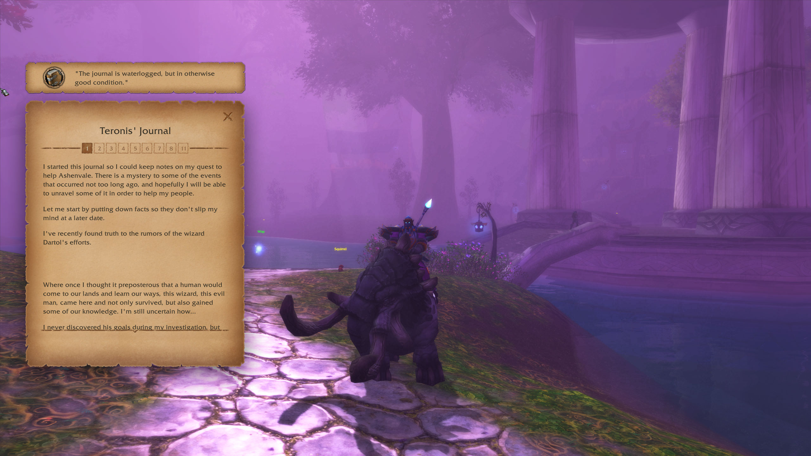
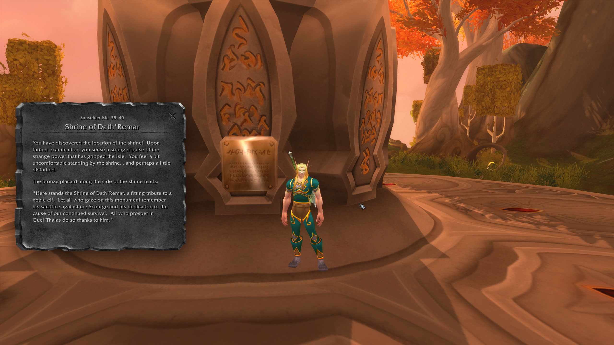
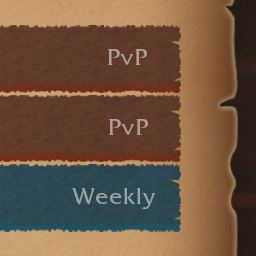
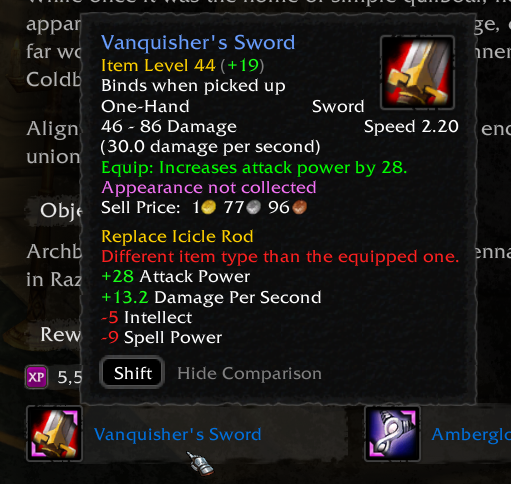
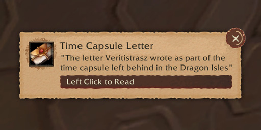

# Dialogue UI (3.3.5a)

A port of the retail **Dialogue UI** addon to **World of Warcraft: Wrath of the Lich King 3.3.5a**. It replaces the default quest and gossip windows with a clean, readable dialogue screen, and adds a few quality-of-life features around quests and readable objects.

## Opening the settings

- Type **/dialogueui**, **/dialogui** or **/dui** in chat. If DragonUI is loaded, **/dui** belongs to DragonUI, so use **/dialogueui** or **/dialogui**.
- Press **F1** while a dialogue is open.
- Click the **minimap button**.

The settings have four tabs: **UI**, **Control** (including custom key bindings), **Gameplay** and **Minimap**.

**Quest UI - Light Theme**



**Quest UI - Dark Theme**



**Book UI - Parchment**



**Book UI - Metal**



## Features

- Select options and accept quests by pressing a keyboard key.
- Adjustable font size and frame size to increase readability.
- Copy dialogue text, with NPC and item IDs.
- Display the lore text when you pick up a quest item.
- Readable objects (books, plaques, notes) in their own window.

## Details

### Two themes
Pick the **Brown** (parchment) or **Dark** theme. You can also change the frame size, font size and which side of the screen the window sits on (or drag it anywhere).

### Quest dialogue
- Quest text, objectives and rewards on one page, with a footer of Accept / Continue / Complete buttons.
- Number-key shortcuts for the options in a quest or gossip list, and a key to confirm.
- Optional **Instant Quest Text** (no fade-in), **Hide UI** while talking to an NPC, and a **Show NPC Name** toggle.

### Quest type label
Shows the type of quest (Daily, Weekly, Dungeon, Raid, Heroic, Elite, Group, PvP, Repeatable) above the title.



### Quest difficulty in the list
When an NPC offers several quests, show the quest level, the difficulty name, or both next to each quest.


### Mark the highest sell price
When you must choose a reward, the item that sells for the most is marked.


### Upgrade arrow and Valuable Reward Popup (needs Pawn)
With the [Pawn](https://www.curseforge.com/wow/addons/pawn) addon installed, reward items that are upgrades for your character get a green arrow. A popup lets you equip such an item directly after turning in the quest.


### Uncollected transmog appearances
On servers with a transmog module (mod-transmog or mod-transmog-plus), reward items whose appearance you have not collected yet get a magenta corner mark and an "Appearance not collected" line in the tooltip. Turn it on with **Show Uncollected Appearances**; check **Using Mod Transmog Plus** if the server runs mod-transmog-plus.



### Quest Item Display
When a quest item is added to your bags, its description is shown and you can use it without opening your bags.



### Copy Text button
Copy the dialogue text, along with NPC and item IDs, to paste elsewhere.


### Readables
Books, notes and other readable objects open in their own window. Choose its size, keep it open when you walk away, show the object's location and item description, and darken the screen behind it.


### Other addons in the item tooltip
Dialogue UI's own tooltip is not a `GameTooltip`, so addons that hook `GameTooltip` cannot add to it. Supported addons are added by Dialogue UI itself (`Code/SupportedAddOns`):

- **Auctionator**: auction price, median price and disenchant value. The vendor line is left out, because the tooltip already shows the sell price.

Any addon can add lines itself:

```lua
if DialogueUI_335_API then
    DialogueUI_335_API.RegisterItemTooltipProvider("MyAddon", function(tooltip, itemLink, count)
        tooltip:AddLine("Some text", 1, 1, 1);
        tooltip:AddDoubleLine("Left", "Right");
    end);
end
```

`tooltip` records `AddLine` and `AddDoubleLine` calls. `count` is the reward's stack size (or nil). The function runs every time the tooltip is drawn.

## Installation

1. Download this repository (Code > Download ZIP) or clone it.
2. Put the folder in `World of Warcraft\Interface\AddOns\` and make sure it is named `DialogueUI_335`.
3. Start the game and enable **Dialogue UI** in the AddOns list on the character select screen.

## Notes

- Built for client **3.3.5a** (Interface 30300) only.
- This is a direct port of [Dialogue UI (YUI-Dialogue)](https://github.com/Peterodox/YUI-Dialogue) by Peterodox. All credit for the design and the original addon goes to them, and many thanks for making it. Some retail features (such as Auto Complete Quest and the Gossip options group) are not included because they do not apply to 3.3.5a.
- Pawn is optional and only needed for the upgrade arrow and the Valuable Reward Popup.
